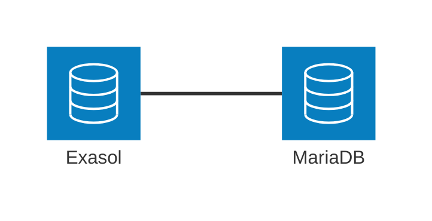
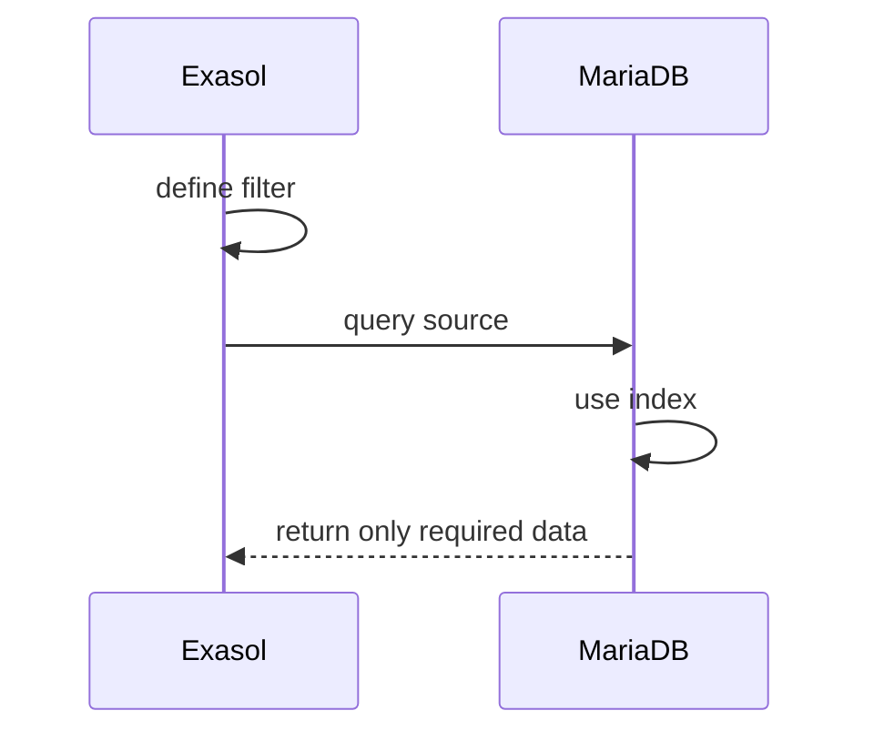
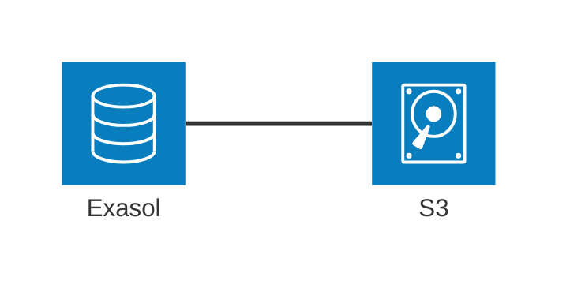
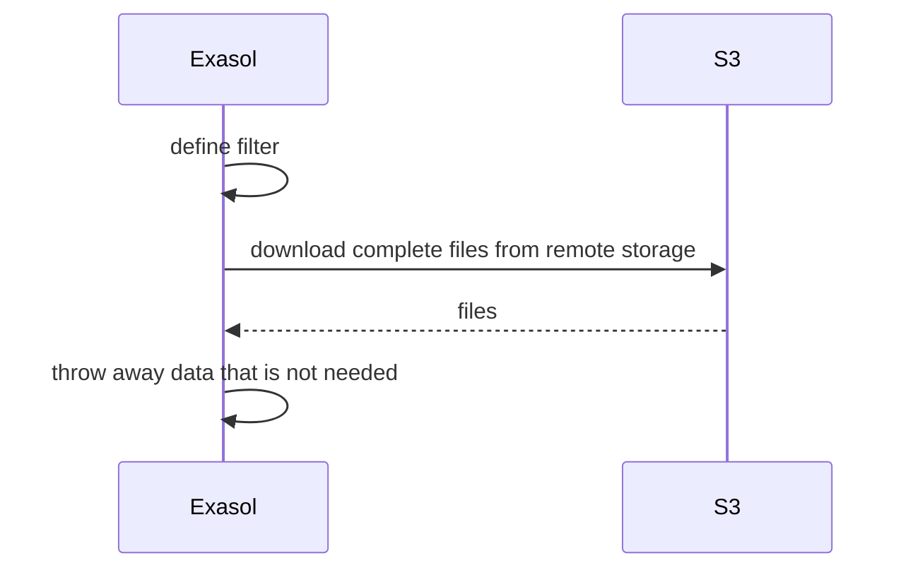

# Filtering Document Columns

This article explains how filtering in document-based Virtual Schemas work and what limitations you need to be aware of.

## Document Files are not a Database

Before we discuss how you can filter document columns, we first need to establish why a document-storage-based Virtual Schema is fundamentally different from one that accesses an external database.

Here is how a database-to-database Virtual Schema works:



A database has an index and an interface that lets you use that interface, for example SQL or a REST API. Indexes make searching and random access to data fast. Below you see a typical chain of events in case a filter is covered by an index.



The secret to why this is efficient is that it offloads the filtering to the source system. This is called "push-down".


When you have your source data in files on a _filesystem_ or _object storage_, you don't know what is inside that file until you read it.



In this case Exasol has to first download the whole file and tehn apply the filter by throwing away what is not needed.



This is a hard limitation when it comes to the efficiency of a document-based Virtual Schema.

## Filtering on the Source Reference

Document-based Virtual Schemas like the S3 virtual schema support filtering only on the source reference. Think of it like a path in a file system. The reason is that this reduces the actual network traffic. If you pick fewer objects (files) from the source, less data needs to be transmitted.

> [!IMPORTANT]
> The Virtual Schema raises an error if you try to apply a filter _directly_ on any other column to let you know that this filter _cannot_ be pushed to the source system.

So in order to make access to your remote data efficient, choose your source reference carefully and make sure that you apply a filter as narrow as possible on this reference.

**Example:**

Let's assume you know that you only need to access your source data in time slices of either a day, a month or a year. And you want to distinguish between production plants. In that case, organizes your source reference so that it supports this filter:

    /plants/munich/2026/05/12/production_log_2026-05-12.csv

Note that all the filter criteria above are in the object reference. That means that instead of downloading thousands of objects, you might only need to download a single one if you need only data from one day.

## Filtering on Columns Inside a Document

Filtering on a column that is inside a document on the other hand means that Exasol needs to load the complete file from the source before it can apply the filter. So pushing down that filter is does not work.

You can still filter the data in Exasol itself of course, but you need to keep in mind that by this time you are essentially only throwing away the parts that you do not need. You already paid the performance price by this point.

### Why Can't Exasol Disable the Filter Capabilities in the Document-based Virtual Schema?

Virtual Schemas can disable capabilities to force the Exasol SQL engine to not push down certain parts of a query.

But, disabling Virtual Schema capabilities is an all-or-nothing decision. There is no way to selectively say "this adapter can filter the object reference only". As a consequence, we enable the filtering capability (`LIKE`) but check in the adapter if the filter is applied to the source reference only. If not, we raise an error.

### Workaround

If you need to filter for a column that is inside a document, then write an inner query that either has no filter or selectively filters for the object reference. This is pushed down by the Virtual Schema.

Then, wrap that in an outer `SELECT` where you apply the remaining filters. This is applied on Exasol.

```sql
SELECT * FROM (
   SELECT * FROM my_virtual_schema ...
)
WHERE column1 LIKE '%foobar%' LIMIT 9E10
```

The reason this works is that Exasol now understands the intent of the query:

1. Fetch the remote files, optionally applying source reference filter
2. Once the files are downloaded, discard all data that does not match the filter criteria from the outer `SELECT`.

> [!NOTE]
> The only purpose of the `LIMIT 9E10` is **preventing the query optimizer from moving the filter criteria to the inner `SELECT`**. When you use this `LIMIT` trick, please make sure that the limit is bigger than the size of the biggest resultset you expect. Otherwise, there is the chance that you truncate your result accidentally.